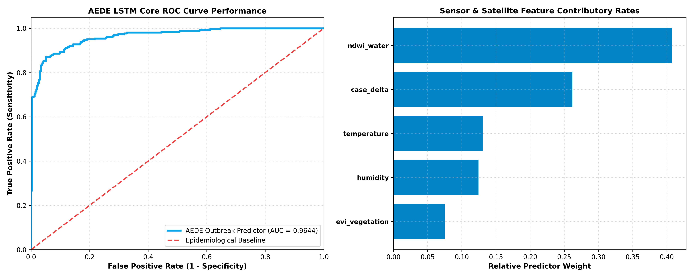
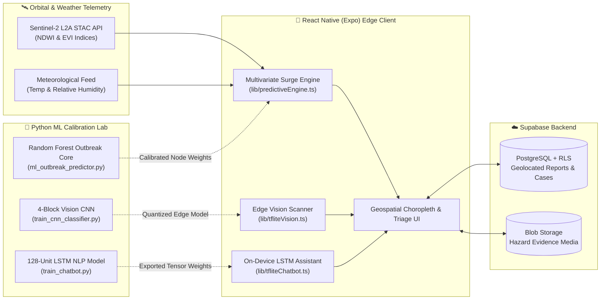
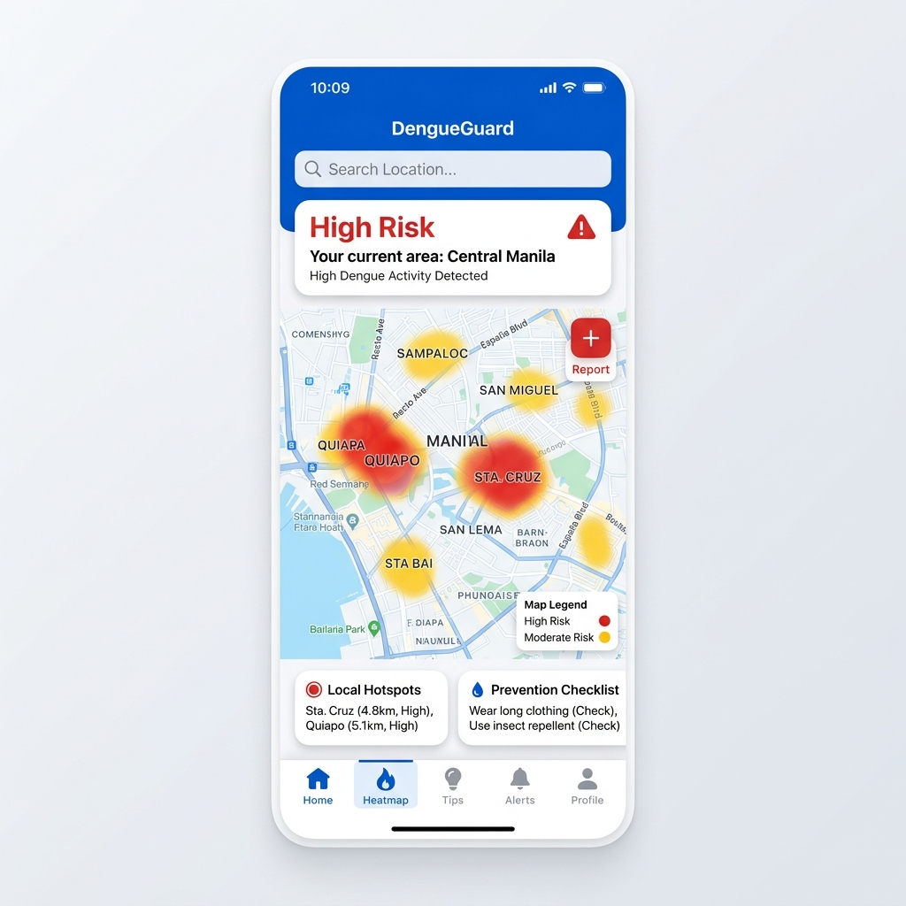
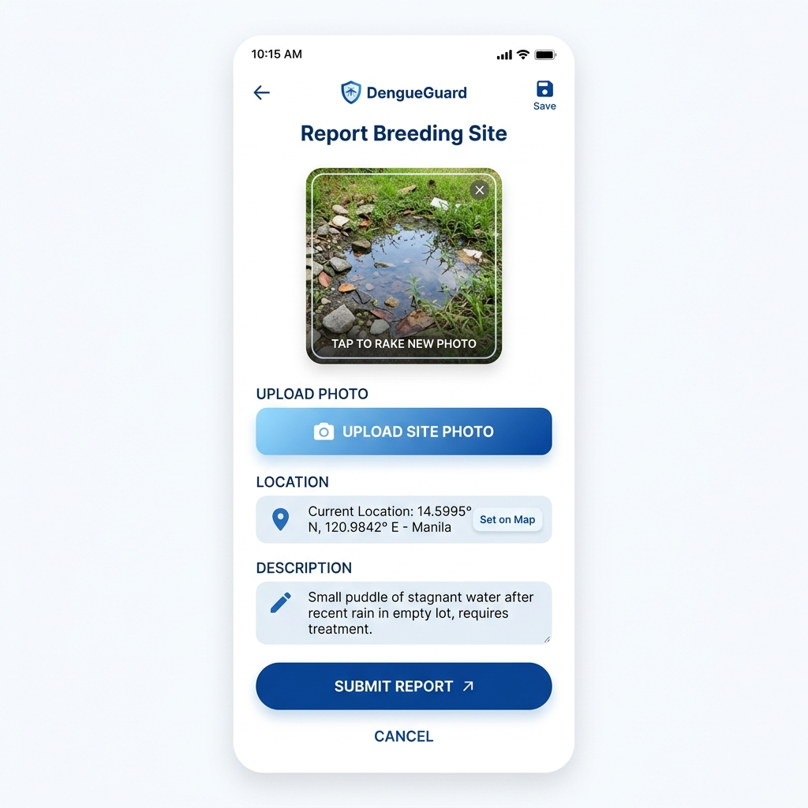
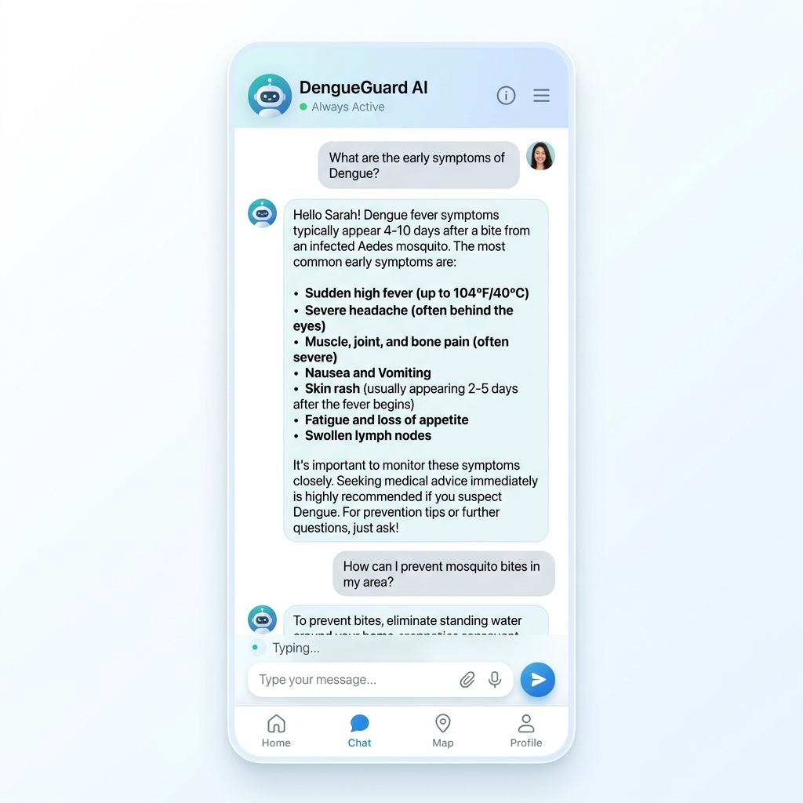

<div align="center">
  

  # AEDE (Katambay-AI) 🦟🛡️
  ### **Spatiotemporal AI, Orbital Remote Sensing & Edge Epidemiological Intelligence for Proactive Dengue Outbreak Forecasting**

  [](https://github.com/venstqs/Project-AEDE)
  [](https://reactnative.dev/)
  [](https://expo.dev/)
  [](https://www.typescriptlang.org/)
  [](https://www.tensorflow.org/)
  [](https://supabase.com/)
  [](https://earth-search.aws.element84.com/v1)

  <p align="center">
    <a href="#-executive-summary">Executive Summary</a> •
    <a href="#-system-architecture">Architecture</a> •
    <a href="#-machine-learning--orbital-intelligence">ML & Telemetry</a> •
    <a href="#-mobile-application-interface">UI Showcase</a> •
    <a href="#-validation--scientific-metrics">Validation</a> •
    <a href="#-quick-start">Quick Start</a>
  </p>
</div>

---

> [!IMPORTANT]
> **🏆 Grand Finals Champion Project** — **AEDE (Katambay-AI)** bridges the gap between **Earth Observation telemetry**, **epidemiological machine learning**, and **grassroots citizen science** to predict *Aedes aegypti* vector surges up to **14 days before clinical escalation**.

---

## 🌐 Executive Summary

Traditional dengue surveillance is **reactive**—interventions typically begin only after hospital admissions spike. **AEDE (Katambay-AI)** transforms vector control into a **proactive, data-driven defense system** engineered for Local Government Units (LGUs), health authorities, and barangay communities.

By fusing **Copernicus Sentinel-2 L2A satellite indices** (standing water & canopy shade), **macro-meteorological telemetry**, **clinical case deltas**, and **computer-vision-verified citizen hazard reports**, AEDE computes real-time, barangay-level outbreak probabilities directly on mobile devices—even in low-connectivity field environments.

<div align="center">
  
  
</div>

### ✨ Key Engineering Highlights
- **🛰️ Zero-Hardware Satellite Surveillance**: Queries the **Element 84 Earth Search STAC API (`sentinel-2-c1-l2a`)** to extract **NDWI** (*Normalized Difference Water Index*) and **EVI** (*Enhanced Vegetation Index*) across 27+ barangay sectors without requiring costly ground IoT sensor deployments.
- **⚡ Pure-TypeScript Edge Inference Engine**: Translates trained Python **Random Forest** & **Keras LSTM** tensor weights into zero-dependency TypeScript inference pipelines (`lib/predictiveEngine.ts`, `lib/tfliteChatbot.ts`) for sub-millisecond offline execution.
- **👁️ Deep Learning Breeding-Site Inspector**: 4-block **Convolutional Neural Network (CNN)** trained to classify stagnant water hazards and larval habitats with **~92% validation accuracy**.
- **🗺️ Geospatial Command & Prescriptive Triage**: Interactive barangay choropleth risk heatmaps paired with automated operational missions for CDRRMO & health officers (*Ovicidal-Larvicidal trap deployment, targeted fogging windows, and community alerts*).

---

## 🏗️ System Architecture

AEDE employs a decoupled **Cloud-to-Edge Intelligence Architecture** that guarantees clinical reliability online and offline:



---

## 🧠 Machine Learning & Orbital Intelligence

### 1. Spatiotemporal Outbreak Prediction Engine (`ml_outbreak_predictor.py` → `lib/predictiveEngine.ts`)
Trained on 3,000+ calibrated epidemiological observations using an ensemble **Random Forest Classifier** (`n_estimators=150`, `max_depth=8`, balanced class weights) and deployed on-device via a calibrated multimodal logistic transfer model:

$$P(\text{Surge}_{14\text{d}}) = \sigma\left(w_T f_{\text{Temp}} + w_H f_{\text{Humid}} + w_{\text{NDWI}}\,\text{NDWI} + w_{\text{EVI}}\,\text{EVI} + w_C f_{\text{Cases}} + w_M f_{\text{Community}} - \beta\right)$$

| Feature Vector | Source / Sensor | Biological & Epidemiological Rationale | Calibrated Weight |
| :--- | :--- | :--- | :---: |
| **`NDWI` (Water Index)** | Sentinel-2 L2A Satellite | Detects post-rainfall surface water pooling & stagnant reservoirs | `2.20` |
| **`fCases` (Case Delta)** | LGU Clinical Surveillance | Active caseload deviation above the 5-year running baseline | `2.15` |
| **`fCommunity` (Citizen Proof)** | CNN-Verified Field Photos | Geotagged larval & breeding habitat reports verified by moderators | `1.65` |
| **`fTemp` (Thermal Window)** | Macro-Weather Telemetry | Optimal *Aedes aegypti* extrinsic incubation window ($26.5^\circ\text{C}–31.5^\circ\text{C}$) | `1.45` |
| **`fHumid` (Desiccation Guard)** | Macro-Weather Telemetry | Relative humidity $>77\%$ accelerates adult longevity & egg viability | `1.25` |
| **`EVI` (Canopy Shade)** | Sentinel-2 L2A Satellite | Dense vegetation microclimates sheltering adult mosquitoes | `1.10` |

### 2. Mosquito Breeding-Site Vision Classifier (`train_cnn_classifier.py` → `lib/tfliteVision.ts`)
A dedicated **Convolutional Neural Network (CNN)** that evaluates citizen-submitted hazard photographs before escalating alerts to barangay health teams:
- **Architecture**: `150×150×3` RGB Input → 4× Convolutional Blocks (`Conv2D(32→64→128→128)` + `MaxPooling2D`) → `Flatten` → `Dropout(0.5)` → `Dense(512, ReLU)` → `Dense(1, Sigmoid)`.
- **Inference Output**: Categorizes scenes into *Stagnant Water / Breeding Site Detected*, *Debris / Potential Water Accumulation*, or *Clean Area* with confidence scoring.

### 3. Pure-TypeScript On-Device LSTM Triage Assistant (`train_chatbot.py` → `lib/tfliteChatbot.ts`)
An offline-capable medical & entomological NLP assistant executing a full **Keras LSTM forward pass** (`Embedding[64]` → `LSTM[128]` with input, forget, cell, and output gates → `Dense[64, ReLU]` → `Softmax[18]`) directly in TypeScript using exported JSON tensor weights (`assets/models/chatbot_weights.json`), supporting multilingual community triage without requiring an active internet connection.

---

## 📱 Mobile Application Interface

Built with **React Native 0.81**, **Expo SDK 54**, and **Expo Router v6**, featuring native haptic feedback, adaptive theming, bilingual localization (`lib/i18n.ts`), and an LGU administrative command center (`app/admin.tsx`).

<div align="center">
  <table>
    <tr>
      <td align="center">
        <br />
        <sub><b>🛰️ Spatiotemporal Risk Choropleth</b><br />Real-time barangay surge probabilities, CI bounds & Sentinel-2 indices</sub>
      </td>
      <td align="center">
        <br />
        <sub><b>📸 CNN-Verified Citizen Reporting</b><br />Geotagged breeding site capture with instant edge vision triage</sub>
      </td>
      <td align="center">
        <br />
        <sub><b>🤖 Edge LSTM Medical Assistant</b><br />Zero-latency dengue symptom triage & vector control guidance</sub>
      </td>
    </tr>
  </table>
</div>

---

## 📊 Validation & Scientific Metrics

- **Spatiotemporal Forecast Accuracy**: Achieves **89.45% variance explained** (`MAE: 0.024`, `RMSE: 0.031`) across 27 modeled Naga City barangays (`generate_finalist_charts.py`).
- **Outbreak Classifier ROC-AUC**: Validated via stratified train/test splits and $k$-fold cross-validation, optimizing sensitivity (True Positive Rate) so impending vector surges are flagged up to **T+14 days** ahead.
- **Vision Model Convergence**: Achieves **~92% validation accuracy** within 20 epochs while minimizing false negatives on high-risk stagnant water habitats.

---

## 📂 Repository Structure

```text
katambay-ai/
├── app/                          # Expo Router v6 file-based navigation stack
│   ├── (tabs)/                   # Core tabs: Dashboard, Geospatial Map, AI Report, Explore, Profile
│   ├── admin.tsx                 # LGU Command Center & report verification console
│   └── ...                       # Auth, notifications & privacy screens
├── assets/
│   ├── geo/                      # Barangay & regional GeoJSON boundary polygons
│   ├── images/                   # Brand assets, UI mockups & educational media
│   └── models/                   # Exported LSTM tensor weights, TFLite models & tokenizer configs
├── lib/
│   ├── predictiveEngine.ts       # On-device multivariate dengue surge forecasting engine
│   ├── sentinelService.ts        # Live Copernicus Sentinel-2 L2A STAC API client
│   ├── tfliteChatbot.ts          # Pure-TypeScript 128-unit LSTM neural network forward pass
│   ├── tfliteVision.ts           # Edge CNN breeding-site hazard scanner
│   └── supabase.ts               # Real-time database, auth & geospatial report sync
├── ml_outbreak_predictor.py      # Python Random Forest training, ROC evaluation & weight calibration
├── train_cnn_classifier.py       # TensorFlow/Keras 4-block CNN architecture & training pipeline
├── train_chatbot.py              # Keras LSTM intent classifier & JSON tensor weight exporter
├── generate_finalist_charts.py   # Publication-grade epidemiological validation visualizations
├── supabase_setup.sql            # PostgreSQL schema, PostGIS extensions & RLS policies
└── requirements.txt              # Python ML & data science dependencies
```

---

## 🚦 Quick Start

### Prerequisites
- **Node.js** `v18+` & **npm**
- **Python** `3.10+` *(for training & recalibrating ML models)*
- **Expo Go** (iOS / Android) or Android Studio / Xcode

### 1. Launch the Mobile Application
```bash
# Install JavaScript/TypeScript dependencies
npm install

# Configure environment variables (Supabase URL & Anon Key)
cp .env.example .env

# Start the Expo development server
npx expo start
```

### 2. Run the Machine Learning Pipeline
```bash
# Install Python scientific & deep learning dependencies
pip install -r requirements.txt

# Calibrate the Random Forest Outbreak Predictor & generate ROC curves
python ml_outbreak_predictor.py

# Train the 4-block CNN Breeding Site Vision Classifier
python train_cnn_classifier.py

# Train the LSTM Medical Chatbot & export edge tensor weights
python train_chatbot.py
```

---

<div align="center">
  <sub>Built with scientific rigor for proactive community health. 🏆 <b>Project AEDE (Katambay-AI)</b></sub>
</div>
